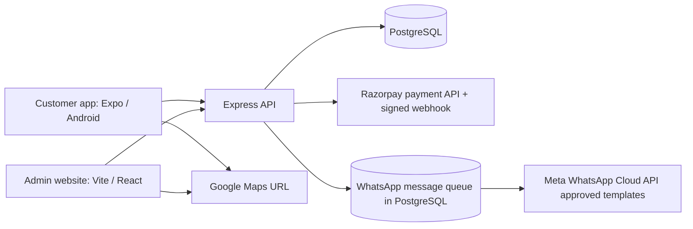

# DollDime payment, WhatsApp and Maps handoff

**Status (15 October 2026):** The code and local database migration are in place. A local scenario uses simulated provider responses. No real payment, WhatsApp delivery, bank settlement or Android release was performed. Razorpay account activation remains on hold as requested.

## What runs where

The payment logic is a **service module within the existing Express API** (`src/services/chit-payments.ts`), not a separately deployed process. That keeps one database transaction for payment confirmation, store balance credit and the message queue. It can be split into its own service later if traffic or team ownership warrants it. The WhatsApp worker runs inside the API process and reads the durable queue.

## Customer payment sequence

1. A customer enrolls in a doll prepayment plan. The API calculates the next installment from the plan and unpaid balance.
2. `POST /api/payment/create-chit-payment` creates or reuses a Razorpay order and stores a matching `chit_payment_intents` row. The app never supplies the amount to credit.
3. Razorpay Checkout collects payment. The app sends the returned order, payment and signature to `POST /api/payment/verify-chit-payment`.
4. The API verifies the checkout signature, fetches the captured payment and order from Razorpay, checks amount, owner and plan, then locks the intent in PostgreSQL.
5. In one transaction it marks the installment captured, advances the plan, credits the customer's store balance once, writes a ledger record and queues a WhatsApp receipt if the customer opted in.
6. `POST /api/payment/webhook` accepts signed `payment.captured` events and invokes the same settlement function. It allows confirmation if the customer closes the app after paying. Duplicate app calls or webhook retries do not credit twice.
7. The customer can use that balance at `POST /api/payment/checkout-with-wallet` to buy catalog dolls. The API checks balance and stock, debits the balance, creates a paid order and reduces inventory in one transaction.

The legacy routes that allowed a client to create an order or credit balance without verified payment now return HTTP 410. Admin staff cannot mark an order paid manually. Paid order cancellation still needs a deliberate refund workflow before launch.

## WhatsApp sequence

1. A customer opens **Profile → Notifications** and separately chooses order/payment updates and offers. Both default to off. The API stores each opt-in time. The customer may turn either off later.
2. A verified payment or paid order queues a transactional notification. The admin **WhatsApp** page queues an approved offer only for opted-in users.
3. The worker checks consent again immediately before sending. It calls Meta's Cloud API with an approved WhatsApp template. It stores the Meta message ID and retries failures.
4. Meta posts signed status updates to `/api/whatsapp/webhook`; the API tracks sent, delivered, read or failed status. Meta verifies the same URL with a GET challenge during setup.

**Templates to prepare and approve in Meta WhatsApp Manager:**

| Environment variable | Category / suggested text with variables |
| --- | --- |
| `META_WHATSAPP_ORDER_TEMPLATE_NAME` | Utility: “Your DollDime order #{{1}} for ₹{{2}} is confirmed.” |
| `META_WHATSAPP_CHIT_TEMPLATE_NAME` | Utility: “{{1}}, your installment for {{2}} of ₹{{3}} was received. Paid so far: ₹{{4}}.” |
| `META_WHATSAPP_WALLET_TEMPLATE_NAME` | Utility: “₹{{1}} was added to your DollDime store balance. New balance: ₹{{2}}.” |
| `META_WHATSAPP_REMINDER_TEMPLATE_NAME` | Utility: “Your {{1}} installment of ₹{{2}} is due on {{3}}.” |
| `META_WHATSAPP_PROMO_TEMPLATE_NAME` | Marketing: An approved offer template with `{{1}}` for the offer detail entered by admin. |

The marketing message entered in admin must match the scope of the approved template. Meta may reject an overly broad variable. Do not send promotions until the business sender and marketing template are approved. If a process dies after Meta accepts a message but before its ID is saved, a retry could duplicate it; reconcile the provider log before bulk campaigns.

## Google Maps delivery link

The saved delivery address appears on the customer's order details and in the admin order detail with an **Open in Google Maps** action. It uses a Google Maps search URL with the encoded address. **No Google Maps API key is required** for this link. A typed address may resolve ambiguously; require a complete address and confirm the pin with the customer before shipping. If you later want autocomplete or a selected map pin saved with the order, add Places/Maps APIs, billing and a restricted key.

## Keys and accounts to supply, in order

Keep live secrets in the deployment host's secret manager or the ignored API `.env`. Never put them in a Git commit or mobile build.

1. **Business hosting and database:** a production HTTPS API domain, admin domain, PostgreSQL `DATABASE_URL` and persistent upload storage. The admin host must proxy `/api/*` to the API so login cookies and existing admin requests use one origin. Set `EXPO_PUBLIC_API_URL=https://api.example.com/api` before building Android.
2. **Application secrets:** `AUTH_TOKEN_SECRET`, `ADMIN_EMAIL`, `ADMIN_PASSWORD`, `ADMIN_SESSION_SECRET`. Use separate long random secrets in production. Set `CORS_ALLOWED_ORIGINS` and `API_PUBLIC_ORIGIN` for the real domains.
3. **Meta WhatsApp Business Platform:** create or connect a Meta business portfolio, WhatsApp Business Account, app and registered sender phone. Provide `META_WHATSAPP_PHONE_NUMBER_ID`, a permanent system user `META_WHATSAPP_ACCESS_TOKEN` with WhatsApp messaging permission, the Meta app's `META_APP_SECRET`, a self-chosen `META_WHATSAPP_VERIFY_TOKEN`, `META_GRAPH_API_VERSION`, language code, and the five approved template names above. Configure the app's **messages** webhook callback to `https://api.example.com/api/whatsapp/webhook`; use the same verify token. Keep all secrets on the server. Customer registration separately uses Twilio SMS: `TWILIO_ACCOUNT_SID`, `TWILIO_AUTH_TOKEN` or API key and secret, and an SMS-capable `TWILIO_FROM_NUMBER`.
4. **Razorpay when account work resumes:** complete business KYC and settlement bank account in Razorpay, then supply `RAZORPAY_KEY_ID`, `RAZORPAY_KEY_SECRET`, and a separate `RAZORPAY_WEBHOOK_SECRET`. Configure `payment.captured` webhook to `https://api.example.com/api/payment/webhook`. Begin with test keys, perform a test payment and check one balance credit; then replace with live keys and perform one low-value live payment/refund under business supervision.
5. **Maps:** no key for the current address link.

## Deploy and check, step by step

1. Back up the production database. Apply [`lib/db/migrations/20261014_integrations.sql`](../lib/db/migrations/20261014_integrations.sql) to PostgreSQL. The migration adds three tables and indexes and does not alter existing data.
2. Set the API variables using [`artifacts/api-server/.env.example`](../artifacts/api-server/.env.example). Keep the real `.env` ignored by Git.
3. Build the API: `artifacts/api-server/node_modules/.bin/tsx artifacts/api-server/build.ts`. Run `node artifacts/api-server/dist/index.mjs` with `PORT`, `DATABASE_URL` and secrets set. Confirm `GET /api/readyz` returns 200.
4. Build admin: `artifacts/admin/node_modules/.bin/vite build --config artifacts/admin/vite.config.ts`. Host `artifacts/admin/dist/public` at `/admin/`. Configure the host to forward `/api/*` to the API; then sign in and check inventory, orders and WhatsApp summary.
5. Build the customer app with the production `EXPO_PUBLIC_API_URL`. The Expo configuration still has a placeholder EAS project ID; set up EAS/Android signing and production package details before Play Store submission.
6. Sign up a test customer through OTP, opt in to both WhatsApp categories, enroll in a plan, pay one test installment, and check Razorpay event, one intent, one balance credit, one ledger entry and one Meta WhatsApp notification.
7. Buy a test doll with the resulting store balance. Check one paid order, one balance debit, reduced stock, notification and the Maps link in customer and admin views.
8. Send an approved promotional template to opted-in test accounts. Turn marketing off for one account before the queue sends and confirm it is cancelled. Check Meta delivery webhooks.
9. Repeat the payment confirmation/webhook to confirm no second credit. Try an unpaid order, invalid signature and insufficient balance; each must be rejected.

The local verifier is [`artifacts/api-server/scripts/verify-integrations.ts`](../artifacts/api-server/scripts/verify-integrations.ts). It uses temporary database rows and mock provider responses, then cleans up. It is not proof of bank settlement or real WhatsApp delivery.

## Provider references

- [Razorpay server integration and payment signature](https://razorpay.com/docs/server-integration/python/test-app/)
- [Meta WhatsApp Cloud API documentation](https://www.postman.com/meta/whatsapp-business-platform/overview)
- [Meta WhatsApp Platform pricing](https://whatsappbusiness.com/products/platform-pricing/)
- [Google Maps URLs: no API key required](https://developers.google.com/maps/documentation/urls/get-started)

## WhatsApp promotions update

The admin promotions workflow now has an audience picker, exact Meta template preview, campaign history, individual delivery results and queued-message cancellation. Apply `lib/db/migrations/20261015_whatsapp_campaigns.sql` and provide `META_WHATSAPP_BUSINESS_ACCOUNT_ID` in addition to the sender credentials. Read [WHATSAPP-ADMIN-GUIDE.md](WHATSAPP-ADMIN-GUIDE.md) for the complete owner checklist and daily admin steps.
